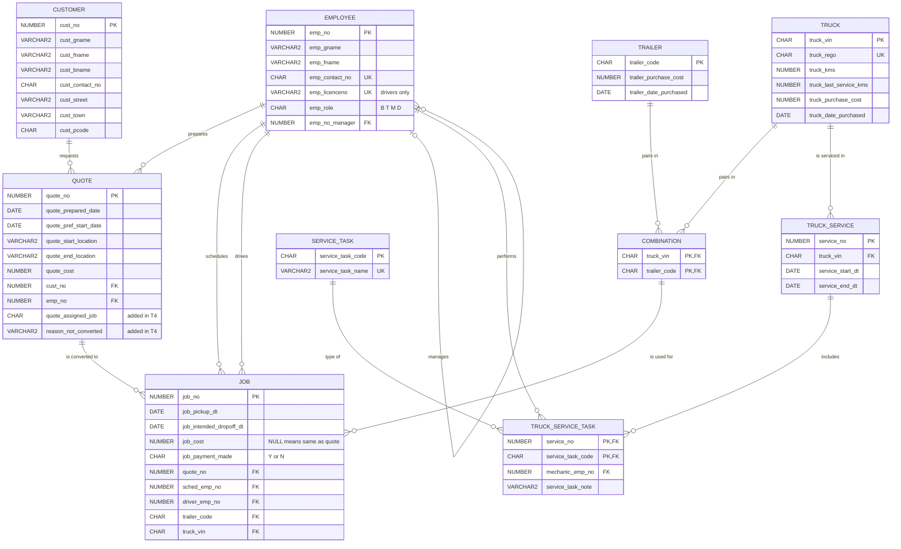

# Big Rig Mover Database System

A relational database for a fictional heavy-haulage company, **Big Rig Mover**, built in Oracle SQL, with a MongoDB document model generated from it.

The database tracks customers, quotes, jobs, staff, the truck and trailer fleet, approved truck/trailer pairings and truck servicing. The SQL scripts cover schema design with declarative constraints, transactional data loading, sequence-based inserts, updates and deletes, schema evolution, reporting queries and SQL/JSON generation. The MongoDB script loads the generated JSON as documents, then queries and updates them.

> **Origin:** I first wrote this project as a university databases assignment (Monash University, FIT2094, 2026). The supplied starter schema has since been replaced with my own implementation and fictional data (see [Data](#data)). The T1–T6 scripts are my original assignment work, with only cleanup and compatibility fixes since.

## Technologies

| Area | Used |
|---|---|
| Relational database | Oracle Database (tested on Oracle Database 23ai Free) |
| SQL tooling | SQL\*Plus / SQLcl, or Oracle SQL Developer |
| Document database | MongoDB (tested on MongoDB 7 with mongosh 2.x) |
| MongoDB tooling | mongosh, or the MongoDB for VS Code playground |

## Database design



Design points:

- **Approved pairings.** A job references `COMBINATION` through a composite foreign key `(trailer_code, truck_vin)`. A job can't be booked with a truck and trailer that aren't approved to work together.
- **One employee table, many roles.** Managers, dispatchers, mechanics and drivers share `EMPLOYEE`, with a role code. A recursive foreign key models the reporting line. A CHECK constraint ensures that only drivers, and all drivers, hold a licence number.
- **Several relationships to the same table.** `JOB` references `EMPLOYEE` twice, once for the dispatcher who scheduled it and once for the driver.
- **Business rules as constraints.** These include a drop-off after pickup, a preferred start date on or after the quote date, non-negative costs, Y/N flags, unique contact and licence numbers, and a last-service odometer reading no higher than the current one.
- **Extensible servicing model (T4).** Service task types live in a lookup table, so new task types can be added without schema changes.

## Repository layout

Run the scripts in this order:

| File | Purpose |
|---|---|
| `ass2-student/brm-schema-insert.sql` | Base tables (`CUSTOMER`, `TRUCK`, `TRAILER`, `COMBINATION`) and fictional seed data |
| `ass2-student/T1-brm-schema.sql` | `EMPLOYEE`, `QUOTE`, `JOB`: columns, comments, PK/UK/CHECK and FK constraints |
| `ass2-student/T2-brm-insert.sql` | Sample data: 10 employees, 30 quotes, 20 jobs, loaded as one transaction |
| `ass2-student/T3-brm-dm.sql` | Sequences, then an insert, update and delete scenario driven by subqueries |
| `ass2-student/T4-brm-mods.sql` | Schema evolution: quote status columns, plus the truck servicing tables |
| `ass2-student/T5-brm-select.sql` | Three reporting queries |
| `ass2-student/T6-brm-json.sql` | Generates one JSON document per customer with SQL/JSON functions |
| `ass2-student/T6-brm-mongo.mongodb.js` | Loads those documents into MongoDB, then queries and updates them |

## Key SQL techniques

- **DDL:** inline and out-of-line constraints, composite primary and foreign keys, a self-referencing foreign key, multi-column CHECK constraints, column comments, and `ALTER TABLE ... ADD` with defaults (T1, T4).
- **Transactions:** T2 loads all sample data as a single transaction with one `COMMIT`.
- **Sequences:** `NEXTVAL` and `CURRVAL` link a new quote to its new job in the same transaction (T3).
- **Subquery-driven DML:** T3 looks up keys by natural attributes (names, roles, dates) instead of hard-coding them. It also includes a correlated `UPDATE` that sets a job's cost from its quote, and a targeted `DELETE`.
- **Set-based updates:** T4 backfills `quote_assigned_job` with `IN` / `NOT IN` subqueries.
- **Reporting (T5):**
  - (a) `GROUP BY` / `HAVING`, compared against an overall average with a subquery
  - (b) self-join with `LEFT OUTER JOIN`, a `CASE` decode of role codes, and a correlated scalar subquery for jobs dispatched
  - (c) multi-table outer joins that keep unused combinations, aggregates, `NVL`, and a usage classification against the average jobs per combination
- **SQL/JSON (T6):** `JSON_OBJECT`, nested `JSON_OBJECT ... FORMAT JSON`, and `JSON_ARRAYAGG ... ORDER BY`, with conditional aggregation to total paid and unpaid job costs.

## MongoDB operations

T6-brm-mongo.mongodb.js uses the `customer_quotes` collection. Each document embeds a customer's quotes and summary statistics.

- **(b)** Drops and recreates the collection, then loads the T6 output with `insertMany`.
- **(c)** Finds customers in Melbourne with at least two quotes, using a dot-notation filter, a regular expression and a projection.
- **(d)** Adds a new customer with `insertOne`. It then records their first quote with `updateOne`, using `$push` to append to the embedded `quotes` array and `$set` to update the nested `customer_stats` in the same operation.

## Setup

### 1. Start Oracle and MongoDB

Any Oracle Database 19c or later and MongoDB 6 or later should work. For local testing with Docker:

```bash
docker run -d --name brm-oracle -p 1521:1521 \
  -e ORACLE_PASSWORD=change_me -e APP_USER=brm -e APP_USER_PASSWORD=brm_pw \
  gvenzl/oracle-free:23-slim

docker run -d --name brm-mongo -p 27017:27017 mongo:7
```

### 2. Run the SQL scripts

From the `ass2-student` folder, connect as the application user and run the scripts in order:

```bash
cd ass2-student
sqlplus brm/brm_pw@localhost/FREEPDB1
```

```sql
@brm-schema-insert.sql
@T1-brm-schema.sql
@T2-brm-insert.sql
@T3-brm-dm.sql
@T4-brm-mods.sql
@T5-brm-select.sql
@T6-brm-json.sql
```

In SQL Developer, open each file and run it as a script (F5).

On a brand-new schema, the `DROP TABLE` / `DROP SEQUENCE` statements at the top of T1, T3 and T4 report `ORA-00942` / `ORA-02289` because there's nothing to drop yet. This is expected: the scripts keep going, and on later runs those statements succeed.

### 3. Run the MongoDB script

```bash
mongosh mongodb://localhost:27017 ass2-student/T6-brm-mongo.mongodb.js
```

The script selects the `big_rig_mover` database itself. You can also open the file in the MongoDB for VS Code extension and run it as a playground, which shows the result of each `find()`.

## Data

All data is fictional:

- **Base tables:** customers, trucks (with invented VINs and registrations), trailers and pairings were written for this project. Customer phone numbers come from the range the Australian Communications and Media Authority reserves for use in fiction.
- **Employees, quotes and jobs (T2):** these were first drafted with Google Gemini from a prompt describing the required mix of rows, then reviewed and edited by hand.

## Testing

Every script was run end to end against Oracle Database 23ai Free (SQL\*Plus) and MongoDB 7 (mongosh 2.14), on both a fresh schema and a re-run. Checks:

- All seed and sample rows load: 20 customers, 10 trucks, 10 trailers, 16 combinations, 11 employees, 31 quotes and 20 jobs after T3.
- The T3 insert, update and delete each affect exactly one row.
- T5 returns the expected reports: 3 customers in (a), 11 employees in (b), and 16 combinations in (c), 6 of them "Never Used".
- T6 produces 6 valid JSON documents. These are identical to the documents loaded by the MongoDB script.
- Deliberately invalid rows are rejected by the foreign keys (unapproved truck/trailer pairing, missing customer, deleting a referenced customer) and by the CHECK constraints (licence/role rule, drop-off before pickup, nameless customer, odometer rule, Y/N flag).
- The MongoDB script runs cleanly twice in a row. Query (c) returns the two Melbourne customers, and (d) leaves the new customer with one quote and updated statistics.
